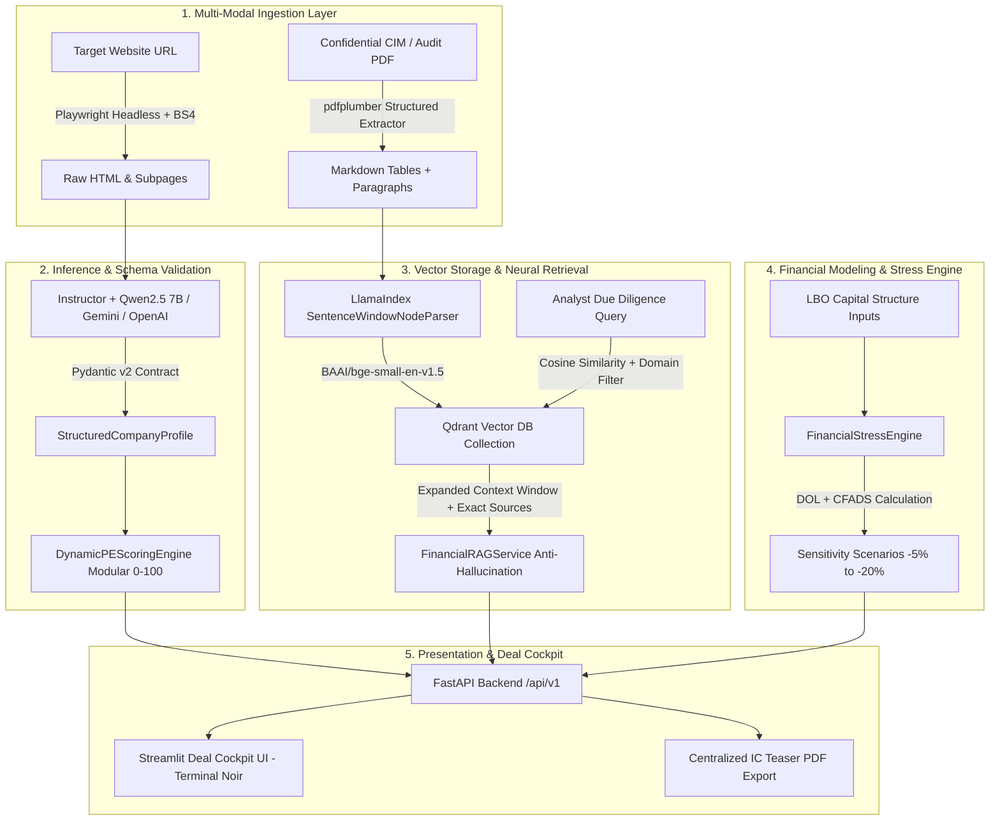

# Private Equity Deal Sourcing & Financial Due Diligence Platform

[](https://www.python.org/)
[](https://fastapi.tiangolo.com/)
[](https://docs.pydantic.dev/)
[](https://streamlit.io/)
[](https://qdrant.tech/)
[](https://ollama.com/)
[](https://www.docker.com/)
[](https://opensource.org/licenses/MIT)

> **Institutional-grade Deal Sourcing & M&A Due Diligence Cockpit** engineered for Mid-Market Private Equity Funds, Investment Committees (IC), and Corporate Finance Advisors. Combines automated web entity ingestion, modular thesis scoring with deal-breaker knockouts, LBO covenant & CFADS stress modeling, and table-aware confidential Data Room RAG document intelligence.

---

## 📑 Table of Contents

1. [Executive Overview & Value Proposition](#-executive-overview--value-proposition)
2. [End-to-End System Architecture](#-end-to-end-system-architecture)
3. [Key Features Deep Dive](#-key-features-deep-dive)
   - [Automated Deal Sourcing & Dynamic Mandate Scoring](#1-automated-deal-sourcing--dynamic-mandate-scoring)
   - [LBO Leverage, CFADS & Debt Covenant Stress Engine](#2-lbo-leverage-cfads--debt-covenant-stress-engine)
   - [Confidential Due Diligence RAG with Data Room Isolation](#3-confidential-due-diligence-rag-with-data-room-isolation)
   - [Buy-and-Build (Roll-Up) Benchmarking Matrix](#4-buy-and-build-roll-up-benchmarking-matrix)
   - [1-Click Investment Committee Teaser Generator](#5-1-click-investment-committee-teaser-generator)
4. [Tech Stack & Engineering Foundations](#-tech-stack--engineering-foundations)
5. [Project Directory Layout](#-project-directory-layout)
6. [Local Installation & Quickstart Guide](#-local-installation--quickstart-guide)
7. [API Reference Summary](#-api-reference-summary)
8. [Hardware Optimization & Benchmarks (RTX 4060)](#-hardware-optimization--benchmarks-rtx-4060)
9. [Roadmap & Institutional Milestones](#-roadmap--institutional-milestones)

---

## 🏛️ Executive Overview & Value Proposition

Traditional Mid-Market Private Equity origination and preliminary due diligence face three structural bottlenecks:

1. **Manual Sourcing & Inefficient Filtering:** Investment teams waste hundreds of hours manually screening unqualified SMEs that lack institutional maturity, B2B cash conversion, or succession angles.
2. **AI Hallucination & Financial Fragility:** Generic LLM wrappers hallucinate critical financial figures, invert operating leverage formulas, or misinterpret non-recurring EBITDA add-backs.
3. **Data Leakage & Privacy Concerns:** Uploading proprietary CIMs (Confidential Information Memorandums) and commercial audit reports to public cloud APIs violates standard M&A Non-Disclosure Agreements (NDAs).

### Core Architectural Differentiators

```
┌──────────────────────────────────────────────────────────────────────────────────────────┐
│                             ARCHITECTURAL DIFFERENTIATORS                                │
├──────────────────────────┬──────────────────────────────┬────────────────────────────────┤
│ Feature                  │ Standard AI Prototypes       │ PE Deal Sourcing Platform      │
├──────────────────────────┼──────────────────────────────┼────────────────────────────────┤
│ Target Scoring           │ LLM hallucinated scores (0-10)│ Modular Engine (0-100) +       │
│                          │                              │ Knockout Deal-Breakers         │
│ Financial RAG            │ Plain text chunking (breaks  │ Table-aware PDF parsing +      │
│                          │ financial statement columns) │ Strict Data Room Isolation     │
│ Data Isolation           │ Third-party cloud endpoints  │ 100% On-Premise GPU Inference  │
│ LBO Stress Modeling      │ Absent or naive fixed margin │ Degree of Operating Leverage   │
│                          │                              │ (DOL) + CFADS + Covenant Buffer│
│ Decoupling               │ Hardcoded monolithic logic   │ Clean REST API + Pydantic v2   │
└──────────────────────────┴──────────────────────────────┴────────────────────────────────┘
```

---

## 🏗️ End-to-End System Architecture



---

## 🚀 Key Features Deep Dive

### 1. Automated Deal Sourcing & Dynamic Mandate Scoring

The platform ingests target company websites via a Windows-safe asynchronous `Playwright` crawler, extracting main navigation paths, value propositions, client portals, regulatory certifications, recurring revenue signals, and contact emails.

The raw content is parsed by `Instructor` into strict `Pydantic v2` models (`StructuredCompanyProfile`) and evaluated by the **Dynamic PE Scoring Engine** through a 4-step institutional process:

1. **Knockout Deal-Breakers:** Pre-screening filters (e.g., Mandatory B2B model, Minimum Headcount cutoff) that instantly assign `🔴 Tier 3 (Discard)` with `0.0 pts` to unqualified targets.
2. **Dynamic Weight Normalization:** Sum of active criterion weights automatically normalized to 100%:
   $$w_i = \frac{p_i}{\sum_{j \in \text{Selected}} p_j} \times 100$$
3. **Modular Scoring Evaluation:** Evaluates active dimensions from the `SCORING_CRITERIA` catalog:
   * **🏗️ Business Model (Commercial):** B2B SaaS (1.0), Industrial (0.93), Logistics (0.83), Services (0.73), Product (0.60), B2C (0.16).
   * **📏 Scale / Headcount (Scale):** Medium Business (1.0), Small (0.72), Large (0.56), Micro (0.20).
   * **💻 Digital Maturity (Value Creation):** Client portals, modern tech stack, eCommerce, tech hiring signals.
   * **🤝 M&A & Succession (Governance):** Buy-and-Build platform fit and founder-led / family-owned dynamics.
   * **💰 Recurring Revenue:** Subscriptions, long-term retainers, maintenance fees, and SaaS pricing.
   * **🏅 Industry Certifications:** Regulatory moats, ISO 9001/27001, GMP, CE markings, and sector licenses.
   * **🌍 Geographic Reach:** International (1.0), Iberian (0.75), National (0.50), Local (0.20).
4. **Institutional Tiers:**
   * 🟢 **Tier 1 (High Priority):** $\ge 75\text{ pts}$ (Prime candidate for Investment Committee review).
   * 🟡 **Tier 2 (Qualified):** $50 - 74\text{ pts}$ (Requires commercial qualification).
   * 🔴 **Tier 3 (Discard):** $< 50\text{ pts}$ (Non-strategic / Out of mandate / Knocked out).

---

### 2. LBO Leverage, CFADS & Debt Covenant Stress Engine

A dedicated financial sensitivity engine (`FinancialStressEngine`) that models the impact of demand contraction on cash flows using the **Degree of Operating Leverage (DOL)** and **Cash Flow Available for Debt Service (CFADS)**:

$$\Delta \text{Costes Variables} = \Delta \text{Ventas} \times \left(\frac{(\text{Ventas} - \text{EBITDA}) \times (1 - \text{Fixed Cost Ratio})}{\text{Ventas}}\right)$$

$$\Delta \text{EBITDA} = \Delta \text{Ventas} - \Delta \text{Costes Variables}$$

$$\text{CFADS} = \text{Simulated EBITDA} - \text{Maintenance Capex (3\%)} - \text{Corporate Taxes (25\%) }$$

* **Covenant Headroom:** Quantifies the exact percentage buffer before breaching the Net Debt / EBITDA threshold.
* **Institutional DSCR:** Computes $\text{CFADS} / \text{Annual Debt Service}$ across $0\%$, $-5\%$, $-10\%$, $-15\%$, and $-20\%$ demand shocks.
* **Capital Structure Modeling:** Integrates amortizable debt schedules (Term Loan A) and bullet interest margin structures.

---

### 3. Confidential Due Diligence RAG with Data Room Isolation

Standard RAG pipelines break financial statements because traditional chunkers slice multi-column PDF tables into illegible fragments.

This platform implements a specialized ingestion and retrieval architecture:
* **Table-Preserving Extraction:** `pdfplumber` isolates tabular coordinates and converts financial statements into clean Markdown pipes.
* **Sentence-Window Retrieval:** `LlamaIndex`'s `SentenceWindowNodeParser` indexes focused sentence units while retaining a $\pm 5$ sentence context window for query-time synthesis.
* **Data Room Isolation:** Every query strictly enforces `company_domain` payload filtering in Qdrant, preventing cross-target data leaks between confidential M&A memorandums.
* **Strict Anti-Hallucination System Prompt:** Enforces strict provenance rules—if a figure is not explicitly recorded, the engine outputs *"INFORMACIÓN INSUFICIENTE EN LOS DOCUMENTOS ANALIZADOS"*, completely forbidding speculative calculations.
* **Granular Source Attribution:** Every response provides the exact filename, page number, semantic similarity score, and verbatim excerpt.

---

### 4. Buy-and-Build (Roll-Up) Benchmarking Matrix

A comparative side-by-side cockpit allowing investment directors to benchmark 2 to 5 targets simultaneously:
* Dynamic comparison across all evaluation criteria, digital maturity signals, and key operational risks.
* Aggregate group synergy analytics: Average PE Score, Roll-up Eligibility count, Generational Transition count, and Digital Gap opportunities.

---

### 5. 1-Click Investment Committee Teaser Generator

Generates executive, institutional-grade 1-page PDF Investment Teasers formatted specifically for Partner / Investment Committee distribution. Rendered cleanly using a headless HTML-to-PDF pipeline with complete visual score breakdowns and knockout notices.

---

## 🛠️ Tech Stack & Engineering Foundations

| Domain | Technology / Library | Version | Purpose |
| :--- | :--- | :--- | :--- |
| **Web Ingestion** | `Playwright` / `BeautifulSoup4` | `1.42.0` | Async headless browser crawling & DOM cleaning |
| **Document Processing** | `pdfplumber` | `0.11.0` | Tabular PDF extraction with Markdown pipe preservation |
| **Structured AI** | `instructor` | `1.1.0` | Strict Pydantic JSON schema extraction from LLMs |
| **Local LLM Inference** | `Ollama` (`Qwen2.5 7B`) | `0.5.x` | On-premise, privacy-first reasoning (Q5_K_M quantization) |
| **Cloud LLM (Fallback)** | Google Gemini / OpenAI | `v1beta` / `v1` | Optional high-throughput enterprise API providers |
| **Vector Store** | `Qdrant` | `1.8.0` | Production vector database with metadata payload filtering |
| **Embeddings** | `BAAI/bge-small-en-v1.5` | `384-dim` | Fast, high-accuracy semantic vector representations |
| **RAG Orchestration** | `LlamaIndex` | `0.10.19` | Sentence-Window parsing & context expansion |
| **Backend API** | `FastAPI` / `Uvicorn` | `0.110.0` | Async REST microservice with automated OpenAPI docs |
| **Data Contracts** | `Pydantic v2` / `Pydantic-Settings` | `2.7.0` | Strict data validation & environment configuration |
| **Frontend UI** | `Streamlit` | `1.32.2` | High-density Terminal Noir Deal Cockpit |
| **PDF Reporting** | `Playwright` / `WeasyPrint` | `1.42.0` | High-resolution Investment Committee Teaser PDFs |

---

## 📂 Project Directory Layout

```text
pe-deal-sourcing-mvp/
├── .env.example                 # Template for environment variables
├── docker-compose.yml           # Multi-container orchestration (FastAPI + Streamlit + Qdrant)
├── pyproject.toml               # Modern Python build & packaging metadata
├── requirements.txt             # Pinned project dependencies
├── run.py                       # Windows-safe startup script with ProactorEventLoop
│
├── app/
│   ├── config.py                # Pydantic BaseSettings configuration
│   ├── main.py                  # FastAPI application entrypoint & API routes
│   ├── streamlit_app.py         # Streamlit Deal Cockpit frontend
│   │
│   ├── models/                  # Pydantic v2 Data Contracts
│   │   ├── financial_schemas.py # LBO sensitivity & EBITDA bridge schemas
│   │   ├── rag_schemas.py       # RAG upload, query & source citation models
│   │   ├── raw_schemas.py       # Raw scraped web page data structures
│   │   ├── scoring_schemas.py   # Modular Criteria Catalog & Mandate Config
│   │   └── structured_schemas.py# Structured SME profiles & Phase B signals
│   │
│   ├── scrapers/                # Web Ingestion Layer
│   │   └── company_scraper.py   # Threaded Playwright scraper with retry logic
│   │
│   ├── services/                # Core Business Logic Layer
│   │   ├── document_service.py  # PDF table parser & Qdrant ingestion pipeline
│   │   ├── extraction_service.py# Multi-provider LLM extractor (Instructor)
│   │   ├── financial_simulation_service.py # LBO DOL, CFADS & Covenant engine
│   │   ├── rag_service.py       # Anti-hallucination RAG reasoning & source citations
│   │   ├── report_service.py    # Executive PDF Teaser generator
│   │   └── scoring_service.py   # Deterministic & Dynamic PE Scoring Engines
│   │
│   └── ui/                      # Frontend Components & API Client
│       ├── api_client.py        # Decoupled REST client for FastAPI
│       └── benchmarking_view.py # Buy-and-Build comparative matrix
│
├── data/
│   ├── processed_json/          # Structured target outputs
│   ├── reports/                 # Generated IC PDF teasers
│   └── uploaded_pdfs/           # Temporary storage for indexed CIMs
│
└── test/
    ├── test_scoring.py          # Deterministic scoring validation tests
    └── test_phase3_rag.py       # End-to-end RAG verification suite
```

---

## ⚡ Local Installation & Quickstart Guide

### Prerequisites

* **Operating System:** Windows 10/11, macOS, or Linux (Ubuntu 22.04 LTS recommended).
* **Python:** Python 3.11 installed.
* **Package Manager:** `uv` (recommended) or standard `pip`.
* **Local LLM Engine:** [Ollama](https://ollama.com/) installed and running.
* **GPU Requirements:** NVIDIA GPU with $\ge 8\text{ GB VRAM}$ (e.g. RTX 3060/4060) for local inference.

---

### Step 1: Clone Repository & Create Virtual Environment

```bash
git clone https://github.com/aiambo08/PE_mvp.git
cd PE_mvp/pe-deal-sourcing-mvp

# Using uv (recommended for ultra-fast setup):
uv venv .venv --python 3.11
.venv\Scripts\activate      # On Windows
# source .venv/bin/activate # On Linux/macOS

uv pip install -r requirements.txt
playwright install chromium
```

---

### Step 2: Configure Environment Variables

Create a `.env` file in the root directory:

```ini
PROJECT_NAME="PE Deal Sourcing MVP"
ENVIRONMENT=development
LOG_LEVEL=INFO

HOST=0.0.0.0
PORT=8000

# Qdrant Vector DB
QDRANT_HOST=localhost
QDRANT_PORT=6333

# LLM Provider Configuration ("ollama", "gemini", or "openai")
LLM_PROVIDER=ollama
OLLAMA_BASE_URL=http://localhost:11434/v1
LOCAL_LLM_MODEL=qwen2.5:7b-instruct-q5_K_M

# Optional Cloud API Fallbacks:
GEMINI_API_KEY=""
GEMINI_MODEL=gemini-2.0-flash
OPENAI_API_KEY=""
OPENAI_MODEL=gpt-4o-mini
```

---

### Step 3: Pull Ollama Local Model

Ensure Ollama is running and download the optimized Q5_K_M quantized Qwen2.5 model:

```bash
ollama pull qwen2.5:7b-instruct-q5_K_M
```

---

### Step 4: Launch Applications

#### 🔹 Option A: Launching Locally

1. **Start the FastAPI Backend:**
   ```bash
   uv run python run.py --reload
   ```
   * Swagger Documentation: [http://localhost:8000/docs](http://localhost:8000/docs)
   * API Healthcheck: [http://localhost:8000/api/v1/health](http://localhost:8000/api/v1/health)

2. **Start the Streamlit Deal Cockpit (in a second terminal):**
   ```bash
   uv run streamlit run app/streamlit_app.py
   ```
   * Interactive Cockpit: [http://localhost:8501](http://localhost:8501)

#### 🔹 Option B: Docker Compose (Full Stack + Qdrant)

```bash
docker-compose up --build
```

---

## 📡 API Reference Summary

| Method | Endpoint | Description | Request Payload | Response Model |
| :--- | :--- | :--- | :--- | :--- |
| `GET` | `/api/v1/health` | Service health status | _None_ | `{"status": "ok"}` |
| `POST`| `/api/v1/analyze-company`| Crawls website & extracts structured profile | `{"url": "https://company.com"}` | `JSONResponse` (Profile + Score) |
| `GET` | `/api/v1/companies` | Lists all analyzed company profiles | _None_ | `List[Dict[str, Any]]` |
| `POST`| `/api/v1/recalculate-scores`| Fast in-memory re-scoring across repository | `InvestmentMandateConfig` | `List[Dict[str, Any]]` |
| `GET` | `/api/v1/companies/{domain}/teaser-pdf`| Centralized Investment Teaser PDF export | _None_ | `FileResponse (PDF)` |
| `POST`| `/api/v1/simulate-leverage`| Runs LBO CFADS sensitivity & covenant matrix | `StressSimulationRequest` | `SensitivityMatrixResponse` |
| `POST`| `/api/v1/upload-document`| Indexes CIM PDF into Qdrant vector store | `Multipart (file, company_domain)` | `DocumentUploadResponse` |
| `POST`| `/api/v1/query-rag` | Queries isolated Data Room with citations | `RAGQueryRequest` | `RAGQueryResponse` |

---

## 📊 Hardware Optimization & Benchmarks (RTX 4060)

The architecture is tuned for consumer GPUs (8 GB VRAM) using strict memory bounds:

```text
+-----------------------------------------------------------------------------+
| VRAM Allocation Breakdown (NVIDIA GeForce RTX 4060 8GB Laptop GPU)          |
+=============================================================================+
| Qwen2.5 7B Instruct (Q5_K_M quantized via Ollama):             ~5.40 GB    |
| BAAI/bge-small-en-v1.5 Embedding Model (PyTorch):              ~0.38 GB    |
| Context Window Buffer (16k max characters limit):              ~0.65 GB    |
| PyTorch CUDA Runtime & Headroom:                               ~0.85 GB    |
+-----------------------------------------------------------------------------+
| Total Peak VRAM Utilization:                                    ~7.28 GB    |
| Safety Headroom Remaining:                                      ~0.72 GB    |
+-----------------------------------------------------------------------------+
```

* **Inference Speed:** $\approx 42 - 48\text{ tokens/sec}$ (FP16 KV Cache offloaded to GPU).
* **Vector Retrieval Latency:** $< 65\text{ ms}$ for Top-4 similarity search in Qdrant.
* **End-to-End Extraction:** $\approx 8 - 14\text{ seconds}$ per target (Scraping + LLM + Scoring).

---

## 🗺️ Roadmap & Institutional Milestones

- [x] **Phase 1:** Asynchronous Headless Scraping with Windows `ProactorEventLoop` safety.
- [x] **Phase 2:** Deterministic PE Target Scoring (0–100) & `Instructor` validation.
- [x] **Phase 3:** Table-preserving Financial RAG with Sentence Window expansion & citations.
- [x] **Phase 4:** Terminal Noir Deal Cockpit, LBO Stress Simulator & Buy-and-Build Matrix.
- [x] **Phase 5:** Modular Criteria Catalog, Knockout Deal-Breakers & CFADS/DSCR Hardening.
- [ ] **Phase 6 (Next):** Automated EBITDA Quality of Earnings (QoE) add-back bridges extracted directly from PDF footnotes.
- [ ] **Phase 7:** Multi-tenant workspace isolation with role-based access control (RBAC).
- [ ] **Phase 8:** Automated connector integrations with S&P Capital IQ and PitchBook API feeds.

---

## 📄 License

Distributed under the **MIT License**. See `LICENSE` for more information.

---

<p align="center">
  <b>Built for Institutional Private Equity & M&A Technology Excellence</b><br>
  <sub>Architected with FastAPI, LlamaIndex, Qdrant, Instructor & Streamlit</sub>
</p>
